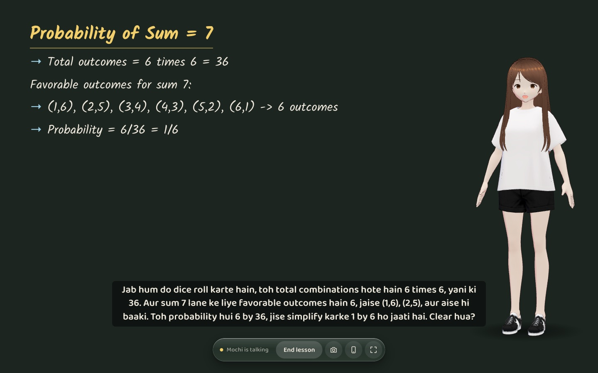
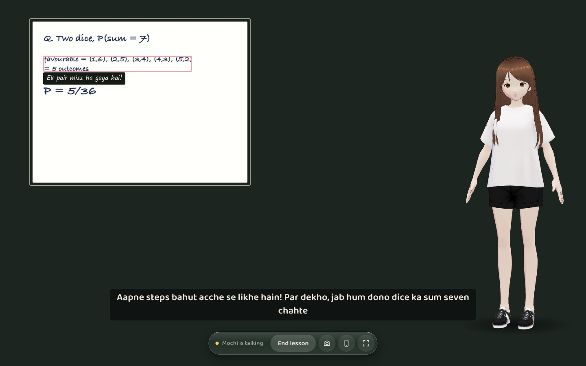
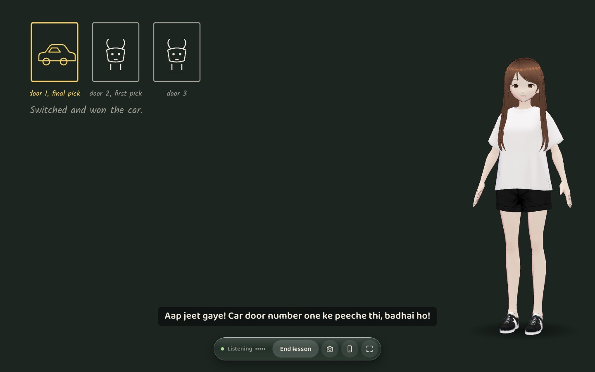
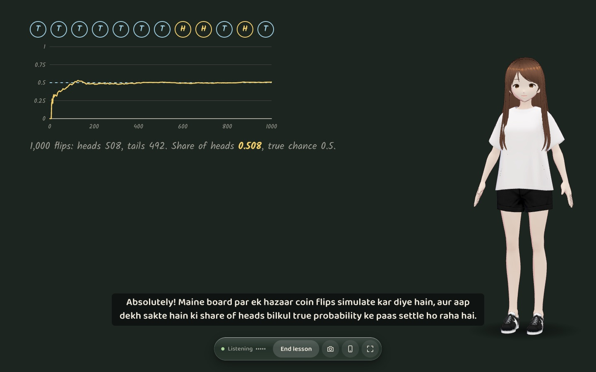
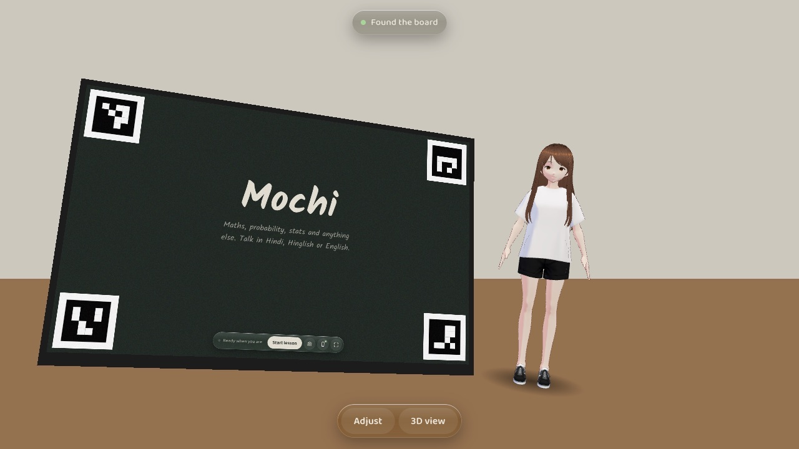

# MochiTutor

A cute 3D tutor that teaches you out loud in Hindi, Hinglish or English. Your laptop screen is the board, and if you point your phone at the laptop you see Mochi standing on the desk next to it.

It's built for maths, probability and stats first. Mochi writes on the board as she talks, runs little simulations, does exact arithmetic instead of guessing, and can look at your notebook through the webcam and circle the step you got wrong.



## What it does

- Live voice in any mix of Hindi and English, and you can interrupt her mid-sentence
- Writes titles, steps and equations on a chalkboard (KaTeX for maths)
- Widgets she drives by voice: coin flips that settle toward the true probability, a Monty Hall game you play by saying door numbers (plus a 1,000-game simulation), a distribution explorer that shades P(a ≤ X ≤ b), and function graphs
- Every number comes from a calculator tool with nCr, factorials, binomial, Poisson, normal and inverse normal, so 6/36 shows up as 1/6, not a guess
- "Check my notebook": a 3 second countdown, a webcam photo on the board, then a box around the wrong step
- A VRoid avatar with lip sync from the audio itself (so it works for Hindi too), blinking, feelings and gestures
- Phone AR in any phone browser, iPhone included: the phone finds four markers in the board's corners and stands Mochi next to the screen

| Notebook check | Monty Hall | Coin flips |
| --- | --- | --- |
|  |  |  |



*The phone screenshot is the viewer running on a rendered camera view of the real board, not a photo from a phone yet.*

## How it works

The laptop does everything that involves sound. It holds the Gemini Live session (`gemini-3.8-live`), streams the mic as 16 kHz PCM, plays Mochi's 24 kHz voice, runs the tools and draws the board. Keeping audio on one device means the browser's echo cancellation works and Mochi doesn't hear herself.

The browser never sees the API key. A small Bun server mints a single-use Gemini token with the prompt and tool list locked in, and the browser connects to Google directly with it. The same server relays a tiny room protocol between the laptop and the phone over WebSocket.

The phone is only a viewer. It tracks the board's corner markers (a 4-code ArUco dictionary, detected in a Web Worker at 1280 px), works out its own focal length from the board's shape, and renders Mochi with three.js and three-vrm on top of the camera feed. The laptop streams mouth shapes, feelings and gestures to it about 30 times a second, and delays its own speakers by roughly one network hop so the lips line up with the voice.

Mochi's own boxes on notebook photos are rough, so when she marks a step the board also asks `gemini-3.5-flash-lite` to find that exact line, and the box slides to the precise spot about two seconds later.

## Run it

You need [Bun](https://bun.sh) 1.3+, Chrome or Safari, and a free Gemini API key from [AI Studio](https://aistudio.google.com/apikey).

```sh
bun install
bun run setup        # .env, a local HTTPS certificate and the sample avatar
# put your key in .env as GEMINI_API_KEY=...
bun run dev
```

Open https://localhost:5173 on the laptop, accept the self-signed certificate once and press Start lesson. Full screen (the corner button) makes the AR line up best.

For the phone: same Wi-Fi, press the phone button in the dock, scan the QR code, tap through the certificate warning (phones only allow the camera on https) and point the phone at the screen so all four corner squares are visible. "Adjust" on the phone tweaks her size, distance and the screen tilt.

To use your own VRoid character, export it as VRM and save it as `public/avatars/mochi.vrm`.

## Numbers

Latency, measured with `bun run bench`. The script streams recorded Hinglish and English questions in real time through the same token path the browser uses, with the app's real config and tool handlers, and times from the end of speech to Mochi's first audio. That includes Gemini's own wait to decide you've finished talking.

- At first Mochi often called a tool (a "react" for her face, or the board) before saying anything, and every tool call before speech costs about 1.4 s while Gemini picks back up. Median 2.95 s, p90 3.40 s over 9 runs, 7 of them with a tool call first.
- So the face now follows her words and the prompt tells her to talk first and draw while explaining. Over 21 runs in two sessions: median 2.09 s, 9 of 21 under 2 s, fastest 1.21 s.
- The tail is long on the free tier: p90 7.5 s and a worst case of 9.5 s, including runs with no tool call at all, so that wait is on Google's side.
- When a question literally asks her to write on the board first, she still draws first: the board fills at about 1.5 s and her voice follows at about 3 s.

Raw results are in `bench/results/` (a Mac on home Wi-Fi in India, October 2026).

Phone tracking, from `tests/pose.test.ts`: on a rendered 1280x720 view of the board from about 50 cm, turned 26° and tilted 17°, all four markers are found, the estimated focal length is within 6%, the rotation within 2° and the distance within 5% of the truth. It hasn't been measured on a real phone yet.

## Checks

```sh
bun test             # 68 tests: maths, simulations, tools, moods, server, rooms, lip sync, pose
bun run typecheck
bun run lint
bun run build
```

## Plan

- [x] Spike: marker tracking, VRM in a browser, Gemini Live latency
- [x] Voice tutor in the browser (Hinglish, interruptible)
- [x] Board with maths and stats widgets and an exact calculator
- [x] VRoid avatar with lip sync, expressions and gestures
- [x] Phone viewer with marker AR
- [x] Notebook check
- [ ] Test the AR on real phones (iPhone and Android) and tune the defaults
- [ ] Attention signals from the webcam
- [ ] Memory between sessions and lesson plans
- [ ] Demo video

## Limits

- The Live models are previews on Google's free tier. Limits can change, and the free tier may use what you send (voice, camera frames) to improve Google's products. Fine for a personal demo, not for other people's kids.
- The phone AR has only been tested against rendered camera images so far.
- Lip sync is worked out from the audio spectrum, so it's convincing at a glance, not perfect.
- The self-signed certificate means a browser warning on first open.

## Credits

The sample avatar is pixiv's VRM 1.0 sample model (VRM Public License 1.0, redistribution allowed). Marker detection is a lightly modified copy of [js-aruco2](https://github.com/damianofalcioni/js-aruco2) (MIT), using the first four codes of OpenCV's DICT_4X4_1000 (BSD-3-Clause).

## License

MIT
